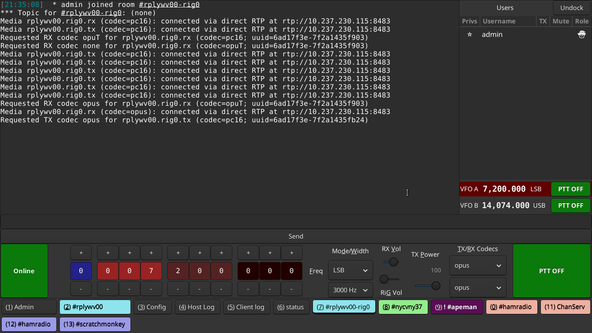
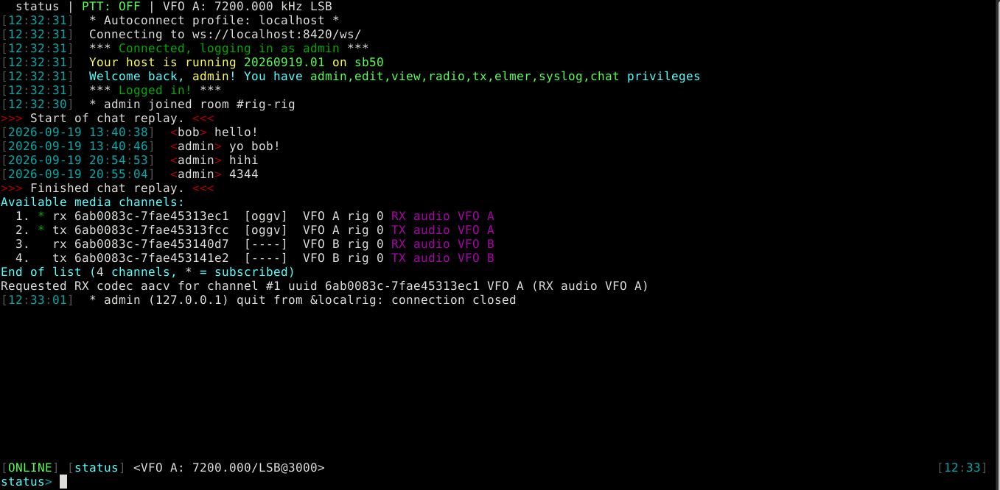
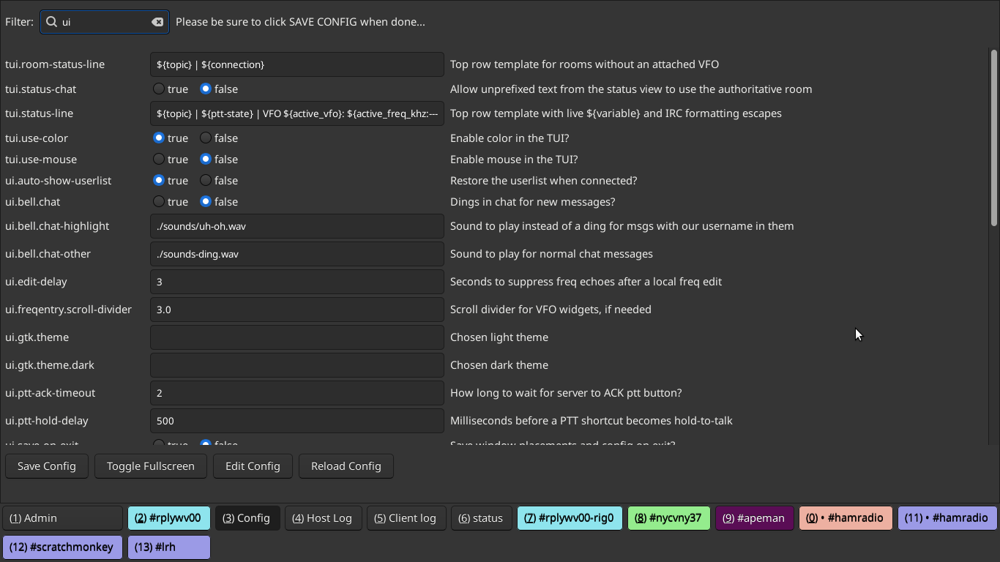
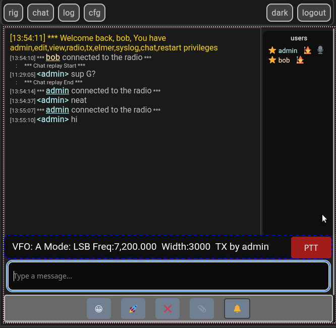

# RustyRig

**Share radios, audio, and station resources over a network.**

RustyRig is an open-source, multi-user amateur-radio platform. Operate radios from another computer, listen with friends, or bring multiple stations together. Operators get live radio controls, audio, chat, and access to the resources they are allowed to use.

RustyRig is under active development. The current releases are for testing; features and configuration can change.

## What you can do

- **Operate together.** Join radio rooms, see who's online, chat, and coordinate transmitter access.
- **Control more than one radio.** Work with supported Hamlib radios and networked rig-control backends.
- **Listen and transmit remotely.** Route receive and transmit audio over the network, with codec selection and per-stream controls.
- **Choose your interface.** Use the Linux GTK desktop client, terminal client, or browser interface.
- **Connect stations.** Link servers to access authorized remote rooms and station resources.
- **Explore SDR receivers.** Browse and connect to supported remote receivers through the SDR Directory.

Additional tools include remote serial/GPS access, audio recording, administration, and station resource discovery.

## See it in action

| Desktop client | Terminal client |
| --- | --- |
|  |  |

| Settings | Browser client |
| --- | --- |
|  |  |

## Get started

RustyRig currently targets Debian-family Linux distributions for building and packaging.

```sh
git clone --recurse-submodules https://github.com/PripyatAutomations/rustyrig-fw.git
cd rustyrig-fw
./install-deps.sh
```

The dependency helper prints the installation command for your selected build profile. Follow the instructions it produces, then continue with the **[quickstart](QUICKSTART.txt)** to build, configure a station, and connect your first client.

**New to RustyRig?** Start with a single server and one radio—or Hamlib's dummy backend—before enabling additional stations or transmit functions.

## Documentation

| Guide | When to read it |
| --- | --- |
| [Quickstart](QUICKSTART.txt) | First installation, login, and connection |
| [Installation and packaging](doc/INSTALLING) | Package and service installation |
| [Radio rooms](doc/rig-rooms.md) | Multiple rigs, room access, and VFO/audio behavior |
| [Audio codecs](doc/media-codecs.md) | Selecting codecs and setting up audio pipelines |
| [IRC client settings](doc/irc-client.md) | Multiple connections and proxies |
| [Changelog](CHANGELOG) | Recent changes and known transitions |
| [Remote SDR architecture](doc/remote-sdr-architecture.md) | Design proposal, **not implemented functionality** |

Configuration examples live in [`config/`](config/). Use `/help` in the client for commands.

## For developers

The main pieces are `rrserver` (server), `rrclient` (GTK/TUI), `rrbridge` (SDR bridges), `librrprotocol` (shared protocol), `librustyaxe` (application support), and `fwdsp` / `libfwdspmgr` (audio). The browser UI is developed in [rustyrig-www](https://github.com/PripyatAutomations/rustyrig-www).

Contributions, hardware compatibility reports, documentation improvements, and reproducible bug reports are welcome. See the [issue tracker](https://github.com/PripyatAutomations/rustyrig-fw/issues).
