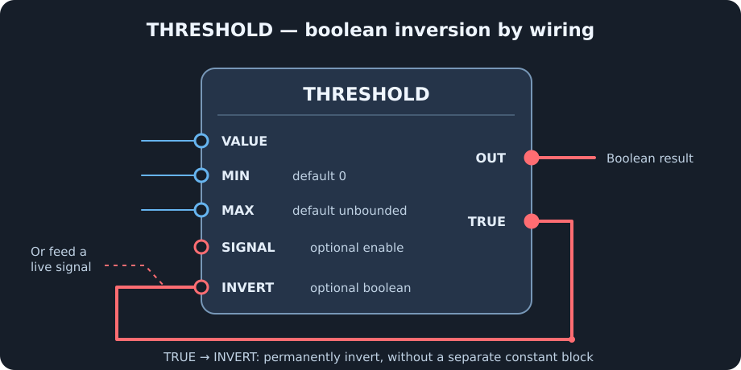
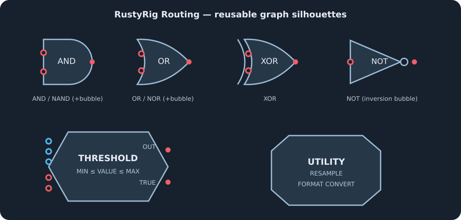

# Audio effect chains and scriptable UI session profiles

**Status:** Work in progress (2026-11-22). This is an implementation plan, not a claim that all features below are live.

## Current LV2 behavior and immediate fixes

The core already supports independent `proc.lv2.N` fwdsp subprocesses and opportunistically consolidates an unbranched, format-matched sequence into one worker. That explains the existing "Consolidated ..." log: the compiler was present before the canvas supported reliably displaying arbitrary effect-to-effect wiring.

In the November 22 patch, the graph registers all effect nodes **before** emitting links. That allows links from higher-numbered slots to lower-numbered slots. Connecting an effect output to another effect's input also disconnects that intermediate output from the RX mixer and persists the mute, so a linear chain is eligible for consolidation. Cycles remain prohibited. Neither change by itself makes LV2 TX processing high-resolution.

### Desired live signal path

```text
Microphone (44.1/48 kHz)
     |  HQ mono/stereo PCM
     v
 LV2 effect 1 -- LV2 effect 2 -- LV2 effect 3     (one fwdsp process if linear)
     |                |
     |        optional monitor/bypass tap
     v
   TX HQ bus / processing output
     |
     v       only at codec boundary
 [resample / channel-map / dither to negotiated codec PCM]
     |
     v
  tx.mix / tx.transport -> current TX media codec
     |
   existing PTT / TX authorization (never controlled by the LV2 route)
```

An ordinary RX effect chain should remain independent from the microphone/TX chain. A user may choose to monitor an effect output locally, but this must **not** key the transmitter.

### Required engineering work

- [x] Render effect-to-effect wiring independently of LV2 slot creation order.
- [x] On effect input patch, mute any directly heard intermediate effect output to avoid duplicated audio; persist route.
- [x] Test reverse-numbered graph link and cycle rejection.
- [ ] Test actual two/three-plugin chains with real LV2 bundles under `make test` and fwdsp process count; validate stereo and saved controls.
- [ ] Display clear input/output compatibility hints and rejected-route reason on the Routing canvas.
- [ ] Handle unlinking a chain without leaving a previously intermediate output unexpectedly silent; decide whether to auto-restore its prior mixer route or explicitly prompt.
- [ ] Make every route change transactional: topology validation, worker preparation, swap, cleanup and rollback on failed relaunch; no lossy partial reconnections.
- [ ] Apply gain and effect parameter changes atomically at the appropriate worker; avoid holding core audio locks across GTK or fwdsp subprocess waits.
- [ ] Preserve `proc.lv2.N` stage identity and persist per-stage controls when stages merge/split.
- [ ] Support microphone as an **HQ PCM source** into LV2, not a 16 kHz tap. Current `client_mic_pcm()` receives mono 16 kHz frames and is fed directly to `tx.mix`; `audio_client_pipeline_recipe(true)` currently requests capture device 44.1/48 kHz but converts **pipeline output** to 16 kHz. Capture device frequency alone does not make the LV2 path high resolution.
- [ ] Extend the fwdsp capture/proc IPC contract to carry format metadata (sample rate, channels, sample format) per stream, or define a versioned worker format on start. Do not reinterpret legacy 16k S16LE packets.
- [ ] Route mic HQ PCM through an HQ-capable client processing bus and LV2 subprocess before codec-specific downsampling.
- [ ] Keep 44.1/48 kHz inside the effect chain, adding conversion only for incompatible plugin requirements and a single downmix at the TX codec boundary; support mono/stereo explicitly.
- [ ] Make `tx.mix` accept/convert the processed HQ output without bypassing the normal TX gate, active codec selection or PTT interlock. Mute dry mic when the processed path owns TX input; preserve dry bypass on failed effect where safe.
- [ ] Bound all asynchronous PCM queues and define failure/recovery: plugin crash must never latch PTT or hang audio.
- [ ] Expose actual process sample rate and topology in Routing diagnostics (not just configured pipeline strings).

## Scriptable workspace/session profiles

### User experience

A small, persistent profile selector in the main toolbar displays the current profile name. **Single click** opens the switcher; **double-click** opens the manager/customization dialog (also supply touch/keyboard-accessible buttons). Actions: **Save Profile**, **Save As**, **Load**, **Edit Script**, **Duplicate**, **Rename**, **Delete**, **Autoload**, and **Revert**. Show modified/dirty state where possible.

Pressing Save Profile captures the current UI session into an in-memory **ordered logical action snapshot** and renders it to an editable `.rrs` RustyScript file in the user's scripts/profile directory (e.g. `~/.config/rustyrig/scripts/profiles/`). The user may explicitly move/mark it for `scripts/autoload/`, but saving must not silently make it autoload. Use atomic write/rename, safe file permissions and clear errors. Do not overwrite an edited profile without confirmation.

### Snapshot scope

- Open tabs, tools, floating panels and controlled windows, with stable **logical IDs** (not GTK pointers).
- Floating/docked position, geometry, zoom, opacity, pin, minimize, roll, and visibility.
- Spectrum source selection, frequency span/zoom/palette/follow mode and AF listening settings where applicable.
- Selected rig/VFO and UI display settings, where appropriate; **do not** automatically send a transmitter tune/key command merely to restore presentation.
- Audio routing graph **actual connections**, gains, bypass states, enabled effect instances, LV2 factories/control values and graph layout.
- Session-independent saved source identities; unresolved remote rigs/SDRs should defer binding until connection becomes available, with a visible warning and retry.
- Optional user-specified startup actions; avoid saving credentials or other secrets.

### Representation and execution

Do **not** generate arbitrary `window.find()` regex calls: several windows may share the same title. Export by stable logical ID and include the schema/profile version. Use a neutral, versioned internal snapshot (value/dict tree) as the source of truth; only then serialize to RustyScript commands. That avoids requiring the script VM to understand every transient GTK detail.

Suggested export *intent* (syntax and host bindings must be implemented before generating an executable script):

```c
// Generated session profile (example; NOT YET EXECUTABLE)
script("/profile-load-workbench", {
    profile.begin("workbench", 1)
    ui.ensure("radio.spectrum.main", "spectrum")
    ui.panel.set("radio.spectrum.main", "dock", "E")
    ui.panel.set("radio.spectrum.main", "zoom", 125)
    ui.panel.set("radio.spectrum.main", "opacity", 85)
    audio.effect.ensure("mic.eq", "some-lv2-factory")
    audio.route.ensure("src.client.dsp0", "mic.eq")
    audio.route.ensure("mic.eq", "tx.mix")
    profile.commit()
});
```

Execution should be an async, transactional phase machine: validate version and permissions, create panels/effects, wait for sources/workers, apply per-widget state, apply audio patches with rate and channel validation, then mark active profile. Avoid synchronous waits on GTK. Report partial/unavailable external resources; never silently claim a profile is fully restored. Explicit **TX-safe default**: loading a profile doesn't assert PTT, arm a transmitter, or override permission checks.

### Database interaction

Keep the current SQLite UI position cache. A named profile provides an **explicit override/snapshot**; without a profile, the database still restores the last normal layout. Loading a profile applies its values and thereafter ordinary database persistence can continue. Decide whether dirty profile edits are saved on explicit Save only (recommended). Never create endless updates by simultaneously auto-saving every UI motion to the profile and default cache.

### Event bus and IDs

Use the `librustyaxe` bus with stable logical widget IDs, per-instance IDs and correlated request/reply IDs (see [LIBRUSTYGUI-TODO.md](LIBRUSTYGUI-TODO.md)). Profile loading needs an ordered transaction ID and completion/error events so effects and panels can be restored after async setup without races. Widgets must expose snapshot/apply capabilities through the same registry that scripts use. Restore must not reference stale widget instances from prior runs.

### Implementation checklist

- [ ] Add snapshot/export/apply interfaces to reusable panel/workspace and audio routing controllers.
- [ ] Add host-script bindings for **specific widget IDs**, exact layout state and explicit graph operations; preserve existing `window.*` commands.
- [ ] Add in-memory profile snapshot and serializer producing actual supported RustyScript syntax; test round-trip parse and replay.
- [ ] Add compact profile name/switch widget to main toolbar with double-click manager and keyboard/touch alternative.
- [ ] Add manager with Save/Save As/Load/Edit/Delete/Duplicate/Autoload.
- [ ] Implement staged async restoration and dependency handling, including disconnected receivers.
- [ ] Wire spectrum and LV2 state snapshots and audio topology/controls.
- [ ] Add undo/revert behavior, overwrite confirmation and safe atomic writes.
- [ ] Test no-profile startup, multi-monitor layout, reconnect, profile switch during active effects, script unload, and invalid/missing files.
- [ ] Add UI integration tests and `make test` regression coverage.

## General-purpose boolean control layer (red pins)

PTT is **not** a special wire type. It is an ordinary boolean control value on
the red signal layer, just like another on/off source. An AND/OR/NOT/XOR/NAND/NOR
block reads boolean inputs and emits a boolean output; the same gate can be
used for PTT, squelch logic, manual conditions, or other digital controls.
A transmitter's PTT **sink**, not the signal or its gate, enforces authorization,
hardware interlocks, watchdog release and failsafe shutdown.

Initial implementation includes `rr_gate_evaluate()`, an independent,
GTK-free truth-table evaluator, its header and a `make test` shell harness.
Inputs have separate `present` and `high` masks; disconnected/stale inputs
force the output **low** and report no valid result. This avoids accidentally
treating an unknown input as false and asserting NAND/NOR/NOT into a transmitter.

Future control graph implementation:

- [ ] Add generic red boolean SOURCE/GATE/SINK nodes and typed input/output
      pins; no PTT-specific edges or conversion logic.
- [ ] Add right-click **Add Gate** and **Properties** with selectable
      AND/OR/XOR/NOT/NAND/NOR type and input count (NOT=1; others >=2).
- [ ] Route boolean values and source validity independently of audio PCM
      frames. Add edge update scheduling, topological ordering, and cycle
      detection; no unbounded feedback or synchronous GTK mutation.
- [ ] Propagate unknown/stale/failed state with fail-closed behavior.
- [ ] Bind physical PTT as an ordinary boolean **source** or **sink** through
      an adapter, keeping TX permissions/interlocks at the physical sink.
- [ ] Ensure changing gate type/inputs recomputes outputs and clears
      asserted state before reconnecting.
- [ ] Test every truth table, disconnect/late updates, cycles, loss of
      source, and disconnect-on-shutdown with PTT asserted.

### Numeric threshold / comparator block



A generic **THRESHOLD** control block compares numeric values and emits one
boolean signal on the red control layer, suitable for keying any boolean
consumer (subject to final sink authorization), triggering a gate, alarm, COS,
squelch or other signal logic.

```text
         +----------------------------+
 VALUE --| INPUT              OUT o  |--- boolean (red)
 MIN ----| MIN (default 0)           |
 MAX ----| MAX (default +inf) TRUE o |--- constant boolean
 SIGNAL -| ENABLE (optional)         |       |
 INVERT -| INVERT (optional)  o------|-------+ (wire TRUE -> INVERT)
         +----------------------------+
```

- Output is **true** only when the enable signal is high (or unconnected)
  and `min <= input <= max`. Comparisons are inclusive.
- `MIN` and `MAX` are optional numeric pins. When unwired, they use
  editable property values initially **0** and **unbounded**, respectively.
  Wired numeric inputs override the properties; values must be finite.
- The optional boolean `SIGNAL` input enables the comparator. Unwired
  means enabled; connected and low means disabled.
- **Wiring shortcut, not a requirement:** `INVERT` accepts an external live
  boolean just like any other control input. Alternatively, connect this
  block's own constant `TRUE` output to its `INVERT` input for permanent
  inversion without inserting an external TRUE/FALSE block. Disconnect
  that wire to return to the normal comparison (assuming the invert
  property is off). This is a user wiring choice, not an automatic link.
- The red `INVERT` input defaults to FALSE when unwired. Connecting the
  block's own always-TRUE red output to INVERT turns it into an outside-range
  comparator. INVERT can also come from another boolean source for dynamic
  inversion. A configured `invert` property is XORed with the connected pin
  value, so both may be used predictably.
- The `TRUE` output is a **constant**, independent of the comparator's
  numeric input health. It can also supply constant enable/high values to
  other control blocks. Where useful, general control blocks may expose both
  `TRUE` and `FALSE` constant outputs; avoid cluttering every node.
- Properties can select `Inside` versus `Outside` (invert comparator).
  **Missing, stale or invalid connected inputs always force a low output**
  even when inverted; NaN and invalid ranges are rejected.
- Future properties: numeric unit/label (Hz, dB, V, %, arbitrary), threshold
  direction, optional hysteresis/debounce to avoid chatter, display precision,
  min/max clamps and comparator state indicator. Unit compatibility must be
  enforced when wiring numeric pins (or through explicit converters).
- Include optional tests for threshold crossing, invalid inputs, noisy values,
  reconnect, gate chains, and signal-type mismatch.

Core foundation also includes the `rr_logic_constant()` helper and the
`invert_connected` / `invert_valid` / `invert_high` state fields.
- [ ] Add both `INVERT` input and `TRUE` constant output to the live
      THRESHOLD canvas node/pin inventory and signal scheduler.
- [ ] Allow self-node connections from TRUE to INVERT, while still preventing
      genuine combinational feedback cycles. Constant outputs are independent
      of the node's comparator result and cannot form a data-dependent cycle.
- [ ] Evaluate INVERT signal freshness separately from the comparator's
      VALUE/MIN/MAX inputs and make stale connections force low.
- [ ] For reusable GATE blocks, consider an optional constant `TRUE` or
      `FALSE` output where valuable, not necessarily both on every block.

Core foundation implemented in `inc/rrclient/audio.logic.h` and
`rrclient/audio.logic.c` through `rr_threshold_default()` and
`rr_threshold_evaluate()`. The actual Routing canvas node/pins, signal
scheduler, property editor, persistent state and live propagation remain TODO.

## Audio rate and block properties

Current fwdsp already supports explicit 44.1/48 kHz capture/playback devices,
generic resampler workers and a 44.1/48 kHz bidirectional processor PCM
contract. The remaining issue is *rrclient's microphone capture callback*,
which receives 16 kHz mono PCM, and the LV2 pipelines built with hardcoded
16 kHz caps. Do not invent a second IPC transport or label 16 kHz packets
as 48 kHz. Use the configured capture sample rate for the HQ path; keep
it unchanged throughout compatible LV2 stages; insert a visible
resampler/downmix only at the downstream 16 kHz bus.

Proposed right-click **Properties** per audio block: input/output rate
(default *Follow upstream*), channels, sample format, buffering and
displayed actual negotiated values; dropdown from supported rates and
manual entry when valid. An explicit "Resampler" utility block bridges
rate domains; other utility blocks may provide channel conversion,
split/join, gain and meter/monitor taps.

When changing a block's rate or channel configuration, offer a dialog with
**Disconnect incompatible audio wires** (safe default) and
**Preserve connections and adapt neighbors** (preview converter insertion/
compatible neighbor retuning). Never modify boolean/control/serial wires
when changing only an audio format. Apply changes transactionally on the
core domain: validate/preview, prepare workers, switch, or roll back if
conversion or worker creation fails. PTT output must fail low when a control
graph connection is invalidated.

## Routing canvas shape language



The shared `gtk.graph.[ch]` Cairo renderer now exposes an explicit
`rr_gtk_graph_shape_t` field, independent of application-specific node
identifiers:

- `RECT` — existing PCM devices, mixers and audio routing nodes (existing
  fwdsp capsules still retain their current visual identity).
- `AND`, `NAND` — D-shaped logic symbols; NAND has an inversion bubble.
- `OR`, `NOR` — curved logic symbols; NOR has an inversion bubble.
- `XOR` — OR silhouette with a second curved input line.
- `NOT` — triangle with inversion bubble.
- `THRESHOLD` — hexagonal comparator.
- `UTILITY` — chamfered converter/resampler rectangle.

Shape drawing and fill-based hit testing use the same Cairo outline path.
The renderer also accepts optional borrowed, named typed ports on a node
(`rr_gtk_graph_port_t`), and draws **numeric inputs blue**, **boolean
inputs hollow red**, and **boolean outputs solid red**. A default THRESHOLD
port inventory describes VALUE, MIN, MAX, SIGNAL, INVERT, OUT and TRUE,
using the same 160×112 routing cell geometry as existing blocks. See
[THRESHOLD-INVERT.svg](THRESHOLD-INVERT.svg) for the intended TRUE→INVERT
shortcut.

**Implementation boundary:** shape/port rendering and shape hit-testing
helpers are implemented, but live control nodes have not yet been added to
the audio graph snapshot, canvas menu, wiring resolver or core signal
scheduler. Rendering a gate silhouette must not be mistaken for a working
PTT/control graph. Current audio nodes remain unchanged by default.

- [x] Add reusable Cairo shape paths and draw them in horizontal/vertical
      graph renderers.
- [x] Add exact outline fill-based hit testing and typed-port drawing helpers.
- [x] Add named THRESHOLD port geometry and regression checks.
- [x] Save reusable SVG reference catalog in `doc/`.
- [ ] Integrate shape-aware block hit testing in the interactive routing
      canvas when control nodes are introduced.
- [ ] Add typed port indices/positions to snapshot **edges** and wire
      hit-testing so wires terminate on the correct boolean/numeric pin.
- [ ] Add GATE/THRESHOLD/UTILITY node creation, context Properties and
      persistence via stable IDs.
- [ ] Connect control scheduler outputs to red control wires without special
      PTT handling; final sink still enforces TX safety.
- [ ] Ensure touch target expansion follows each shape's visible outline.

## References

- [Existing LV2 worker design](audio-processors.md)
- [Reusable GUI architecture and ID/event protocol](LIBRUSTYGUI-TODO.md)
- [Existing RustyScript UI API](RUSTYSCRIPT-UI.md)
- [Existing panel placement script](examples/scripts/panel-layout.rrs)
