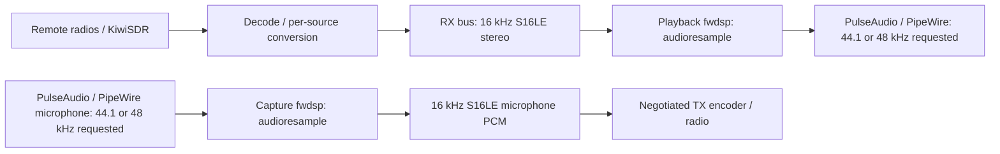

# Client audio sample-rate domains

## Current implementation (November 2026)

The client can request **Auto (48 kHz preferred)**, **44.1 kHz** or **48 kHz**
separately for its microphone and playback device:

```ini
audio.capture-rate=auto
audio.playback-rate=auto
```

These settings affect the PulseAudio/PipeWire-facing endpoints in the stock
`src.client.dsp0` and `sink.client.mix` GStreamer pipelines. Use the Config
interface or `/set` and save normally. Restart rrclient to reopen both
endpoints at new rates. Custom pipeline strings stay authoritative; edit
their caps manually when a different device rate is needed.

**Important:** the current RustyRig PCM mixer, network codec endpoints,
fwdsp framing, legacy AF analysis and recording taps have **not** been
converted to 48 kHz float PCM. They remain 16 kHz S16LE in the paths documented
by `doc/audio-processors.md`. The GStreamer boundary converts the audio
between that contract and the preferred sound-device rate. A 48 kHz output
does not restore audio frequencies missing from a narrowband source.

The Audio Routing graph shows `rx.mix` as the current 16 kHz bus, the
`sink.client.dsp0` playback endpoint with the *requested* device rate,
and the independent `src.client.dsp0` capture endpoint. Microphone capture
is read-only in the RX routing graph; it is **not** an RX mixer input.
Requested rate is not a measurement of the sound card's actual negotiated
rate. The display must not imply otherwise.

### Current signal paths



See [audio rate domain diagram](audio-rate-domains.svg) for the source graphic.

## Planned architecture: dynamic per-rate AF buses

The desired long-term mixer uses native-rate buses, created only as required
by active sources. Multiple compatible sources can share a bus before
resampling its output once into a destination domain. Example buses:
8, 12 and 16 kHz for narrowband ham/SDR sources, 44.1 kHz for consumer
audio, and 48 kHz for high-quality receivers and microphone audio.

Each bus needs explicit sample format, channel layout, sample clock domain,
timestamps, latency budget, and overflow/underflow telemetry. Equal sample
rates do not imply a shared physical clock: unsynchronized sources still
require drift correction and bounded buffering. Avoid resampling when source
and destination rate and clocks are compatible. Keep complex I/Q out of
ordinary AF mixing; modem plugins operate across explicit AF/IQ boundaries.

Ultimately the ordinary AF mixing domain should favor 48 kHz float32, with
a configurable 44.1 or 48 kHz playback destination and independent mic
capture rate. Resample only at boundaries, use native-rate processing when
advantageous and preserve high-quality source bandwidth up to the selected
radio mode's limits. High-quality local broadcast listening should not
require modifying ham-radio network codec negotiation.

The Audio Routing interface is the control-plane inventory of all active
buses, rate adapters and endpoints. Each should appear as a node with
sample rate, channels, format, clock domain, buffering and health properties,
even if topology modifications are not yet supported. Never invent an
active bus or processing node merely to illustrate an architectural plan.

### Planned automatic GStreamer graph generation

A later pipeline builder can derive and validate GStreamer graphs from
typed source/sink descriptors and AF bus connections instead of hand
written static launch strings. It must support fwdsp subprocess isolation,
per-endpoint device caps, GStreamer negotiation failure diagnostics, and
runtime graph inspection. Preserve existing manual override pipelines.

For now **do not** introduce this generator and **do not** change the
16 kHz media protocol, codec negotiation or fwdsp transport.
