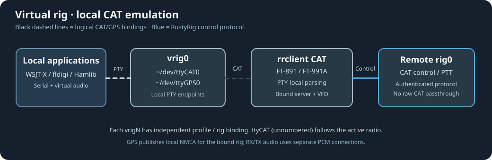

# Virtual Rigs — CAT, GPS, and audio routing



**Implementation:** The numbered CAT/GPS endpoints are local client PTYs. `ttyCAT0` does **not** tunnel raw serial bytes across the RustyRig mesh: it parses FT-891/FT-991A CAT commands locally and issues rig-control requests through the explicitly bound server connection. `ttyGPS0` publishes NMEA associated with its bound rig. The unnumbered `ttyCAT`, `ttyGPS`, and `ttyMODEM` remain floating aliases of the active radio.

## Numbered endpoint ownership

Local `ttyCATN`, `ttyGPSN` and `ttyMODEMN` names are reserved for virtual rigs. Direct `[serial]` mappings and `/sercom attach` cannot create these names; disconnect through the routing graph. Custom non-reserved serial names remain available. Numbered modem exports are created by directed serial graph wires. The unnumbered active-rig aliases remain unchanged.

## Virtual Rigs manager

The **Virtual Rigs** toolbar button opens a movable panel. For each `vrigN`, select the server profile and its `rigN` identity, then **Bind**. A successful bind configures the corresponding local `~/dev/ttyCATN` and `~/dev/ttyGPSN` endpoints. Bindings are persisted in the client database and reconstructed at startup. The actual PTYs are generated by the existing `sercom` subsystem.

## Routing

The Routing canvas shows virtual-rig CAT and GPS pins alongside the underlying rig targets. Black circles and **black dashed connections** represent *logical serial bindings*, distinct from PCM audio wires and green effect-control wires. Drag CAT to CAT or GPS to GPS to bind a virtual rig to a target. Moving the virtual-rig blocks saves their position without modifying a binding. Touch uses larger invisible hit regions; long-press opens context menus where supported.

CAT and GPS graph wires are independently bound and disconnected. The legacy manager's Bind action still binds both ports together. Old paired settings are inherited until an individual port is explicitly changed. Separate audio RX/TX routes remain independent and should not be confused with CAT/PTT permission. A graph link does not confer transmit rights. The server still validates control privileges and PTT.

## Multi-server safety

A background CAT command is dispatched through the owning PTY's selected server connection and room, not through the foreground GUI's `ws_conn` pointer. A disconnected or unresolved CAT binding must fail closed; it must never fall back to another rig.

The runtime `ws_conn` variable has been removed. Core handlers read the current connection through `rrclient_connection_context()`; GUI handlers choose their foreground connection through `rrclient_active_connection()`. Long-lived video capture retains a profile name rather than a borrowed connection pointer. Legacy `ws_conn` symbols in isolated tests are test-only fixtures. Explicit connection arguments and queued core actions are still preferred over cross-thread pointer access.

## Future extensions

Per-virtual-rig PipeWire/PulseAudio input/output devices, independent CAT/VFO arbitration, and multiple simultaneous TX encoders/mixers remain separate follow-on features. A virtual rig should eventually expose `vrigN.rx`, `vrigN.tx`, `ttyCATN`, and `ttyGPSN` together.

For the shared Routing pin/wire legend (including yellow COS and red PTT), see
[Routing pin colors](routing-pin-colors.md).

## Modem serial wiring

Each virtual rig has independent serial TX (application to modem) and RX (modem to application) connections. The common core owns these wires, persists them and creates ttyMODEMN only while at least one exists. Modem inputs accept one producer; outputs may fan out. The current PSK adapter forwards decoded bytes and accepts input during an explicitly armed keyboard TX stream; serial wiring itself does not grant transmit permission or key the radio.

GTK and TUI expose Serial TX/RX on the virtual rig and on the same modem block as audio and PTT. TUI also permits keyboard patching and wire removal from Properties. Drag TX to RX; double-click the wire to remove it. The equivalent RustyScript calls are:

```
routing.connect("vrig0.serial_tx", "modem1.serial_rx");
routing.connect("modem1.serial_tx", "vrig0.serial_rx");
routing.disconnect("vrig0.serial_tx", "modem1.serial_rx");
```

The command-line equivalents are:

```
/sercom wire 0 tx 1
/sercom wire 0 rx 1
/sercom wire 0 tx 0
/sercom wire 0 rx 0
```

The first two commands connect both directions between vrig0 and modem1; the last two remove the individual wires. The transport is length-delimited and preserves NUL and high-bit bytes; individual modem protocols may impose additional restrictions.

RustyScript also provides `command.run("/sercom wire 0 tx 1")` through the normal client command parser. Prefer the typed routing API for scripts that need to manipulate graph connections directly.

## Virtual audio exports

Right-click a virtual rig and select Export virtual sound device, or use `routing.vrig.audio(0, true)`. The core requests 48 kHz stereo PulseAudio-compatible null sinks and a remapped microphone. External applications select `rustyrig.vrig0.rx` for capture and `rustyrig.vrig0.tx` for playback. The internal RX sink is `rustyrig.vrig0.rx_internal`; the TX capture source is `rustyrig.vrig0.tx.monitor`. The manager does not set default devices. PCM patching is a separate step; until those routes are implemented, the virtual devices carry no radio audio.
